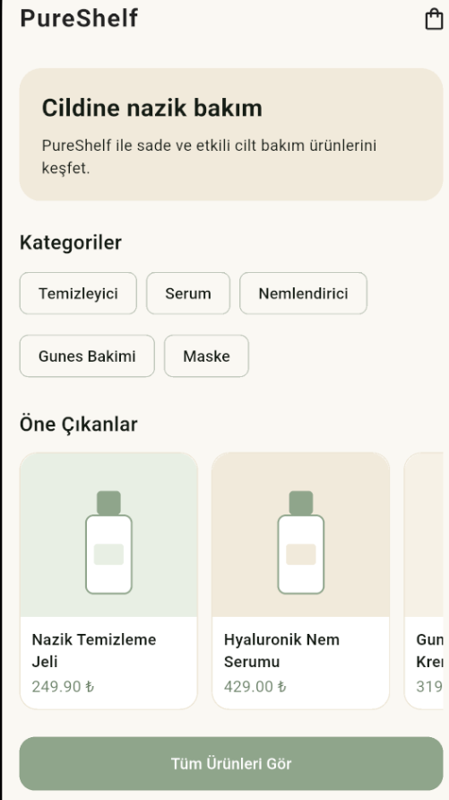
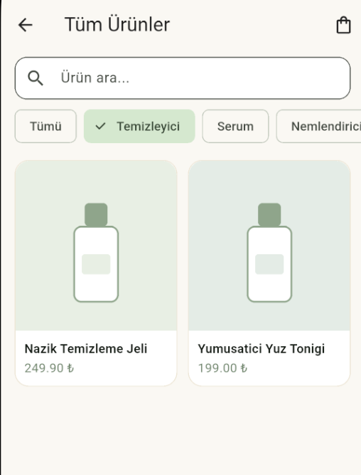
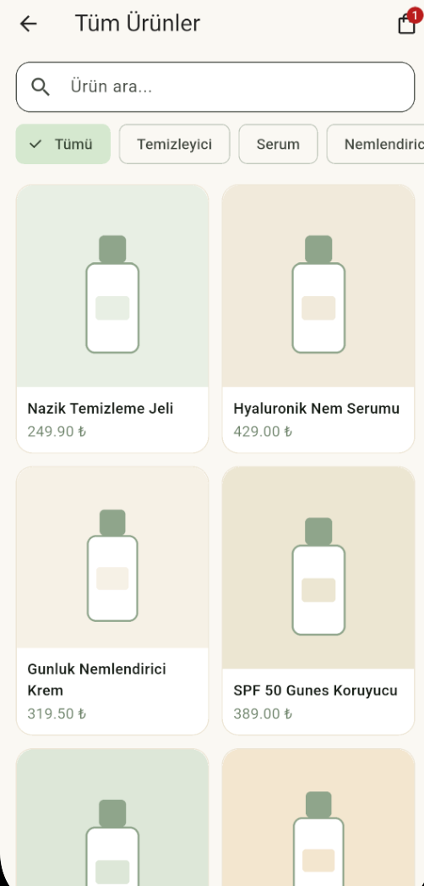
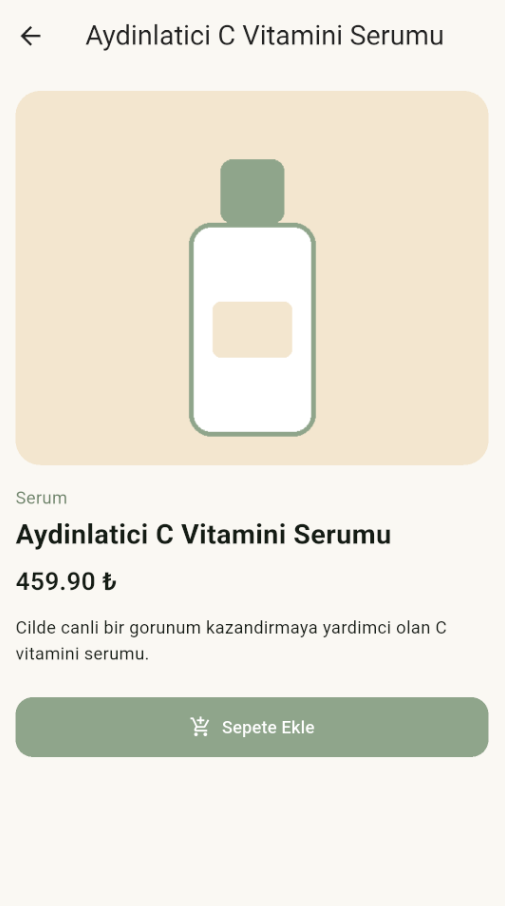
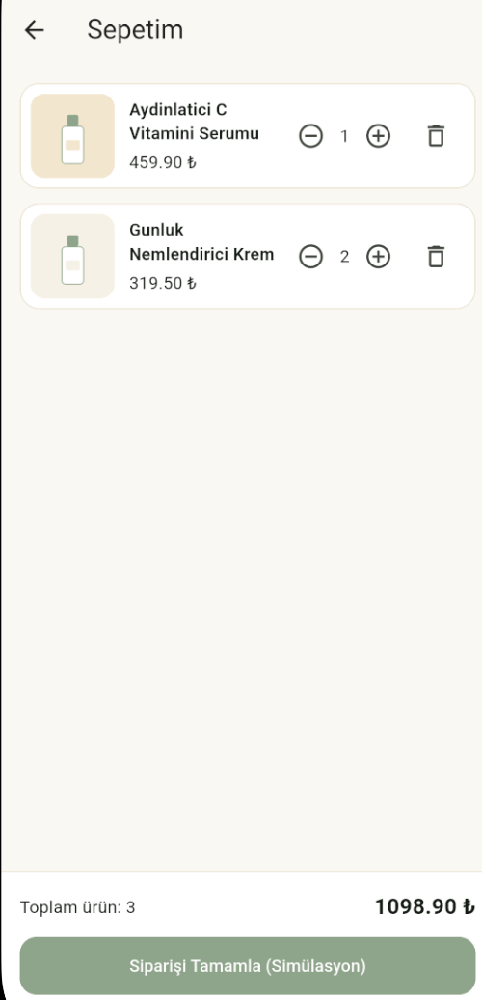

# PureShelf

PureShelf, Flutter ile geliştirilmiş, eğitim amaçlı bir mini kozmetik ve cilt bakım ürünleri kataloğu uygulamasıdır. Uygulama; ürünleri JSON dosyasından okuma, ürünleri listeleme ve filtreleme, ürün detaylarını görüntüleme ve temel bir sepet simülasyonu gibi Flutter'ın temel özelliklerini göstermeyi amaçlar.

> **Not:** PureShelf bir eğitim projesidir. Gerçek ödeme sistemi, kullanıcı hesabı, stok yönetimi veya çevrim içi ürün servisi içermez.

## Özellikler

- **Ana sayfa:** Tanıtım alanı, kategoriler, öne çıkan ürünler ve sepet göstergesi.
- **Ürün listesi:** İki sütunlu GridView ile ürün kartları, ürün arama ve kategori filtreleme.
- **Ürün detayları:** Ürün görseli, adı, kategorisi, fiyatı ve açıklaması.
- **Sayfa geçişleri:** Navigator, Navigator.push, Navigator.pop ve MaterialPageRoute kullanımı.
- **Veri aktarımı:** Ekranlar arasında Route Arguments ile ürün bilgilerinin aktarılması.
- **JSON kullanımı:** Ürün verilerinin yerel JSON dosyasından okunması.
- **Model sınıfı:** Product modeli ile fromJson ve toJson metotları.
- **Asset yönetimi:** Yerel ürün görsellerinin Image.asset ile gösterilmesi.
- **Sepet simülasyonu:** Ürün ekleme, adet değiştirme, ürün silme ve toplam tutarı hesaplama.
- **State yönetimi:** Temel durum güncellemeleri için setState kullanımı.


## Screenshots

### Home Screen


### Product List


### Product List — All Products


### Product Detail


### Shopping Cart



Pureshelf/
├── android/
├── assets/
│   ├── data/
│   │   └── products.json
│   └── images/
├── lib/
│   ├── data/
│   │   ├── cart_service.dart
│   │   └── product_service.dart
│   ├── models/
│   │   └── product.dart
│   ├── screens/
│   │   ├── cart_screen.dart
│   │   ├── home_screen.dart
│   │   ├── product_detail_screen.dart
│   │   └── product_list_screen.dart
│   ├── widgets/
│   │   ├── product_card.dart
│   │   └── product_image.dart
│   └── main.dart
├── screenshots/
├── test/
├── .gitignore
├── pubspec.lock
├── pubspec.yaml
└── README.md

## Kullanılan Teknolojiler

- Flutter SDK
- Dart
- Material Design (`material.dart`)
- Visual Studio Code
- Android Studio ve Android Emulator

Projede ek Flutter paketi kullanılmamıştır.

## Kurulum ve Çalıştırma

### Gereksinimler

- Flutter SDK 3.47.7
- Dart SDK 3.13.5
- Android Studio (Android Emulator için)
- Visual Studio Code
- Git

### Projeyi İndirme

Terminali açın ve aşağıdaki komutları sırasıyla çalıştırın:

```bash
git clone https://github.com/elifsudetopcu/Pureshelf.git
cd Pureshelf
```

### Bağımlılıkları Yükleme

Flutter bağımlılıklarını yüklemek için:

```bash
flutter pub get
```

Flutter kurulumunu kontrol etmek için:

```bash
flutter doctor
```

### Uygulamayı Çalıştırma

Android Studio üzerinden bir Android Emulator başlatın. Ardından proje klasöründe şu komutu çalıştırın:

```bash
flutter devices
flutter run
```

Uygulamayı belirli bir cihazda çalıştırmak için `flutter devices` çıktısında görünen cihaz kimliğini kullanabilirsiniz:

```bash
flutter run -d CIHAZ_KIMLIGI
```

**Not:** `CIHAZ_KIMLIGI` yerine kendi cihazınızın kimliğini yazın.


### Flutter Sürümü

Bu proje aşağıdaki geliştirme araçlarıyla hazırlanmıştır:

- **Flutter SDK:** 3.47.7
- **Flutter Channel:** stable
- **Dart SDK:** 3.13.5
- **Flutter Framework Revision:** `abaf9c5237`
- **Flutter Engine Revision:** `deb287481e`
- **DevTools:** 2.60.0

Projeyi çalıştırmadan önce Flutter kurulumunuzu kontrol edin:

```bash
flutter --version
flutter doctor
flutter pub get
```